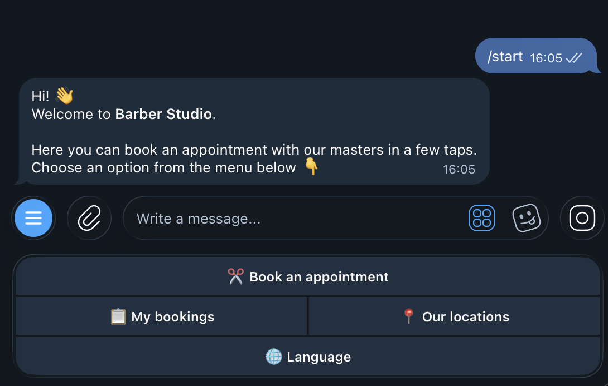
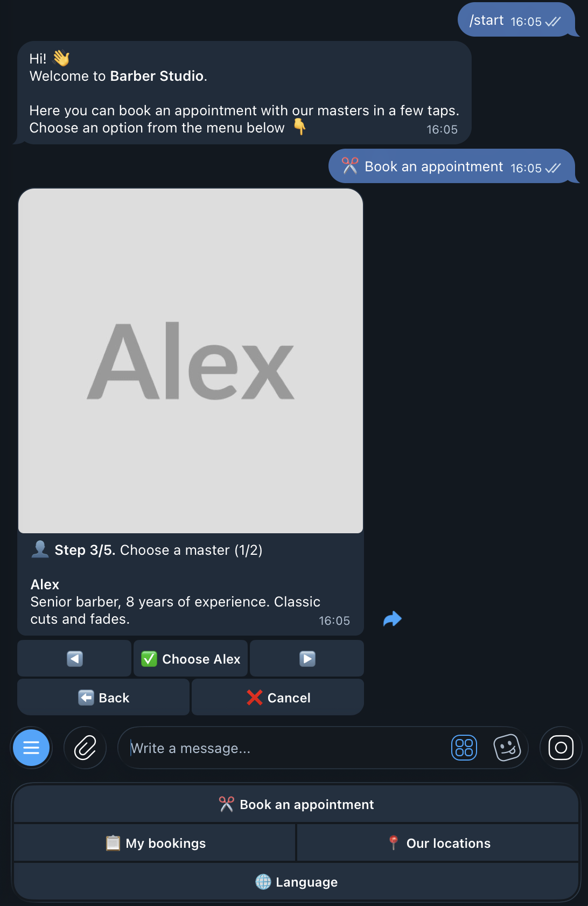
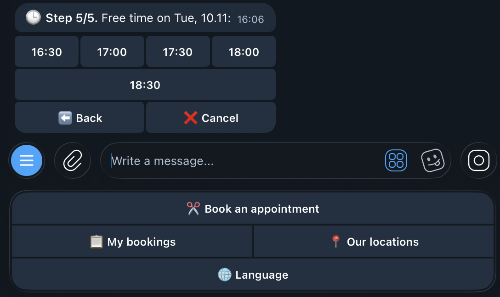
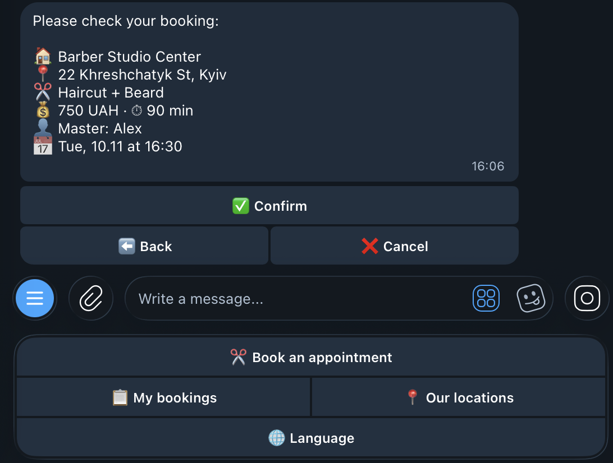
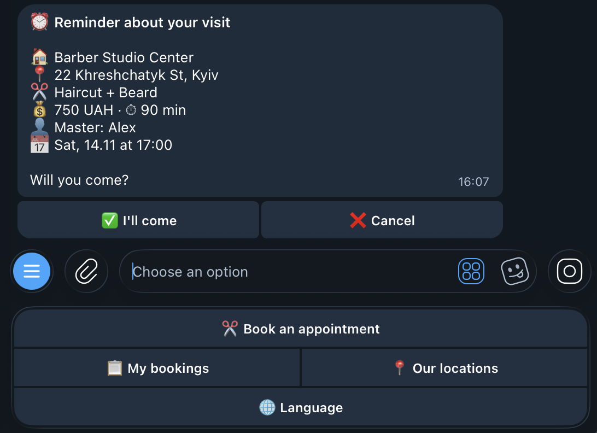
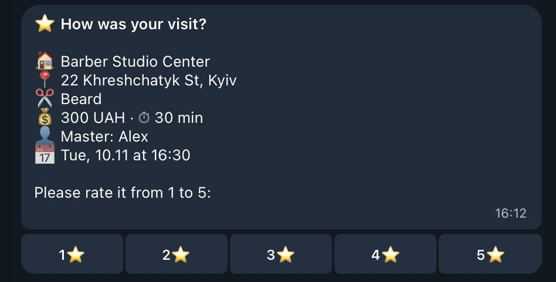
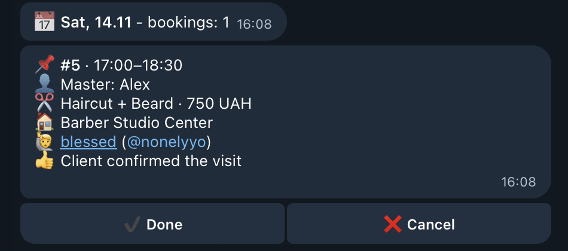
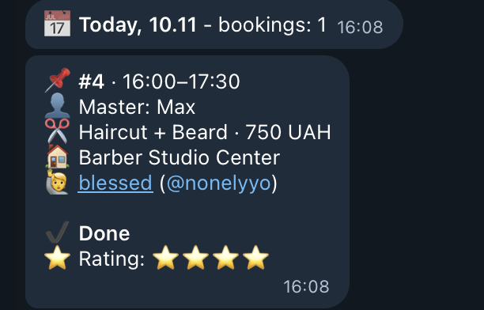
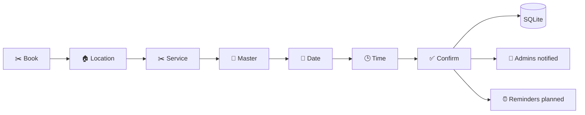

# ✂️ Telegram Booking Bot for Barbershops & Salons

A Telegram bot that lets clients book an appointment with a master in a few taps, and lets the owner manage the schedule right from Telegram. No website or app needed.

Built with **Python 3**, **aiogram 3**, **SQLite** and **APScheduler**. English 🇬🇧 and Ukrainian 🇺🇦 included.

> 🤖 **Try the live demo:** [@barbershop_barbershop_bot_bot](https://t.me/barbershop_barbershop_bot_bot)  
> 🌐 **Website with Telegram booking:** [blessedrbls.github.io/barbershop-site](https://blessedrbls.github.io/barbershop-site/)

---

## ✨ Features

### 🙋 For clients

- 🌐 **Two languages.** English (default) and Ukrainian. The language is chosen at `/start` and can be changed with `/language` at any time.
- ✂️ **Step-by-step booking.** Location → service (with price and duration) → master → date → time → confirmation.
- 👤 **Master cards.** A photo, name and description for each master, browsable with ◀️ ▶️ arrows.
- 🕒 **Only real free time.** 30-minute slots that take the service duration into account. Busy, past and days-off slots are never shown.
- ⬅️ **Back and Cancel on every step.** The whole booking happens in one message, so the chat stays clean.
- 📋 **My bookings.** All upcoming bookings with a cancel button (and an "Are you sure?" step).
- ⏰ **Reminders 24 h and 2 h before the visit** with **✅ I'll come** / **❌ Cancel** buttons.
- ⭐ **Rating after the visit (1–5).**
  - 4–5 ⭐: the client gets a link to leave a review on Google Maps.
  - 1–3 ⭐: the bot asks what went wrong and forwards the feedback to the admins.
- 📍 **Our locations.** Addresses and opening hours, with a Google Maps button for each location.

### 🔐 For admins

- 🔔 **Instant notifications** about new bookings, cancellations and negative feedback.
- 📅 **Admin panel (`/admin`)** with bookings for today, tomorrow or any date. The date picker shows how many bookings each day has.
- 📋 **All upcoming bookings** in one compact list, grouped by day.
- ✔️ **Mark as done** or ❌ **cancel** any booking. The client is notified in their own language.
- 🚫 **Days off.** Close a day for a specific master with one tap, and clients can no longer book it.
- 🤖 **Auto-complete.** If the admin forgets to mark a visit as done, the bot does it 2 hours after the visit ends.
- 🧪 **Test commands.** `/test_reminder` and `/test_review` show scheduled messages instantly, which is handy for demos.

### 🛡️ Reliability

- 🔒 **No double bookings.** A database transaction makes sure two clients can never take the same slot, even if they press "Confirm" at the same second.
- 🔄 **Survives restarts.** Reminders and rating requests are restored from the database when the bot starts. Messages missed while the bot was offline are sent right after it starts.
- 🧩 **Safe database updates.** New columns are added to an existing database automatically, so no data is lost.

---

## 📸 Screenshots

### 🙋 Client side

<table>
  <tr>
    <th>Main menu</th>
    <th>Choosing a master</th>
    <th>Free time slots</th>
  </tr>
  <tr>
    <td valign="top"></td>
    <td valign="top"></td>
    <td valign="top"></td>
  </tr>
  <tr>
    <th>Booking confirmation</th>
    <th>Reminder</th>
    <th>Rating after the visit</th>
  </tr>
  <tr>
    <td valign="top"></td>
    <td valign="top"></td>
    <td valign="top"></td>
  </tr>
</table>

### 🔐 Admin side

<table>
  <tr>
    <th>Active booking</th>
    <th>Completed booking with rating</th>
  </tr>
  <tr>
    <td valign="top"></td>
    <td valign="top"></td>
  </tr>
</table>

---

## ⚙️ How it works

### Booking flow



The steps are an **FSM** (finite state machine) from aiogram. The bot remembers which step every user is on, so each button press is handled in the right context. Choices made so far are stored in the FSM data, and every step edits the same message instead of sending a new one.

### Free time slots

For the chosen day, the bot walks through the master's working hours in 30-minute steps (10:00, 10:30, 11:00, …). A slot is shown only if:

1. the service **ends before the master finishes work** (a 90-minute service can't start at 19:00 if work ends at 20:00);
2. it is **not in the past**;
3. it **does not overlap** any existing booking (two time ranges overlap if each one starts before the other ends);
4. the day is **not a day off** for this master.

Days with no free slots are hidden from the date picker.

### Scheduled messages

**APScheduler** sends these messages:

| What | When |
|---|---|
| ⏰ Reminder | 24 h and 2 h before the visit |
| ✔️ Auto-complete | 2 h after the visit ends (checked every 10 minutes) |
| ⭐ Rating request | 2 h after the visit is marked as done |

APScheduler keeps jobs in memory, so the database stores what has already been sent (`reminder_24h_sent`, `reminder_2h_sent`, `review_sent`). On every start the bot plans everything that is still waiting again. Reminders that aren't needed are skipped: for example, a booking made 5 hours before the visit doesn't get a "24 hours before" reminder.

### Database

| Table | What it stores |
|---|---|
| `users` | Telegram users and their language |
| `branches` | Locations: name, address, opening hours, Google Maps link |
| `services` | Services: name, price, duration |
| `masters` | Masters: location, description, photo, working hours |
| `master_services` | Which master does which service |
| `bookings` | Bookings: time, status, reminders, rating, feedback |
| `days_off` | Days when a master doesn't work |

On the first run the database is filled with **demo data**: 2 locations, 4 services and 3 masters working 10:00–20:00.

---

## 🧰 Tech stack

| | |
|---|---|
| 🐍 **Python 3.10+** | language |
| 🤖 **[aiogram 3](https://docs.aiogram.dev/)** | asynchronous Telegram Bot API framework (routers, FSM, filters) |
| 🗄️ **SQLite + [aiosqlite](https://github.com/omnilib/aiosqlite)** | database with async access |
| ⏰ **[APScheduler](https://apscheduler.readthedocs.io/)** | reminders and other scheduled jobs |
| 🔐 **[python-dotenv](https://github.com/theskumar/python-dotenv)** | secrets (token, admin IDs) in a `.env` file |
| 🕰️ **zoneinfo + tzdata** | all times in the `Europe/Kyiv` timezone |

---

## 📁 Project structure

```
telegram-booking-bot/
├── bot.py              # Entry point: starts the bot, routers and scheduler
├── config.py           # Settings: token, admins, timezone, slot step, reminder times
├── database.py         # Tables, demo data, migrations and all SQL queries
├── texts.py            # All texts in English and Ukrainian
├── keyboards.py        # All buttons and keyboards
├── states.py           # FSM states (booking steps, waiting for feedback)
├── slots.py            # Free time slot calculation (no Telegram code)
├── reminders.py        # Scheduled jobs: reminders, auto-complete, rating requests
├── utils.py            # Shared helpers: booking summary, admin notifications
├── handlers/
│   ├── user.py         # /start, language, locations
│   ├── booking.py      # Booking flow
│   ├── my_bookings.py  # My bookings, cancelling, "I'll come"
│   ├── review.py       # Rating and feedback after the visit
│   └── admin.py        # Admin panel and test commands
├── requirements.txt
├── .env.example        # Template for your .env file
└── .gitignore
```

---

## 🚀 Installation & launch

You need **Python 3.10 or newer**. Check your version with `python3 --version`.

**1. Clone the repository**

```bash
git clone https://github.com/blessedrbls/telegram-booking-bot.git
cd telegram-booking-bot
```

**2. Create a virtual environment and install dependencies**

```bash
python3 -m venv venv
source venv/bin/activate        # Windows: venv\Scripts\activate
pip install -r requirements.txt
```

**3. Create the `.env` file**

```bash
cp .env.example .env            # Windows: copy .env.example .env
```

Open `.env` and fill it in:

```env
BOT_TOKEN=1234567890:AAH...your-token...
ADMIN_IDS=123456789
```

- **BOT_TOKEN.** Create a bot with [@BotFather](https://t.me/BotFather) (`/newbot`) and copy the token.
- **ADMIN_IDS.** Your Telegram ID from [@userinfobot](https://t.me/userinfobot). Separate several admins with commas: `111,222`.

**4. Run the bot**

```bash
python bot.py
```

When you see `Bot started` in the terminal, open your bot in Telegram and press **/start**. The database file `booking.db` and the demo data are created automatically on the first run.

> 💡 Every admin must press `/start` in the bot once. Telegram doesn't let bots message users who never started them.

### Commands

| Command | Who | What it does |
|---|---|---|
| `/start` | everyone | Main menu (language choice on the first visit) |
| `/language` | everyone | Change language |
| `/admin` | admins | Admin panel |
| `/test_reminder` | admins | Send a reminder for your nearest booking now |
| `/test_review` | admins | Send a rating request for your latest completed booking now |

### Settings

All settings live in [`config.py`](config.py):

| Setting | Default | Meaning |
|---|---|---|
| `TIMEZONE_NAME` | `Europe/Kyiv` | Timezone of the business |
| `SLOT_STEP_MINUTES` | `30` | Step between time slots |
| `BOOKING_DAYS_AHEAD` | `7` | How many days ahead clients can book |
| `REMINDERS` | `24h`, `2h` | When reminders are sent |
| `REVIEW_DELAY_HOURS` | `2` | Delay before asking for a rating |
| `AUTO_COMPLETE_HOURS` | `2` | Delay before a visit is marked as done automatically |

---

## 🔮 Possible improvements

- 📱 Ask for the client's phone number with a "Share contact" button
- 🛠️ Manage masters, services, prices and working hours from the admin panel
- 📊 Statistics: revenue, number of visits, average rating per master
- 💳 Online prepayment (Telegram Payments, LiqPay, Monobank)
- 📆 Google Calendar sync for masters
- ☕ Breaks and different working hours per weekday
- 📝 Waiting list: notify the client when a slot becomes free
- 📢 Broadcast messages to clients (promotions, news)
- 🐳 Docker + PostgreSQL + webhooks for production deployment
- 🧪 Automated tests with pytest

---

💬 **Need a bot like this? Contact me on Telegram: [@nonelyyo](https://t.me/nonelyyo)**
